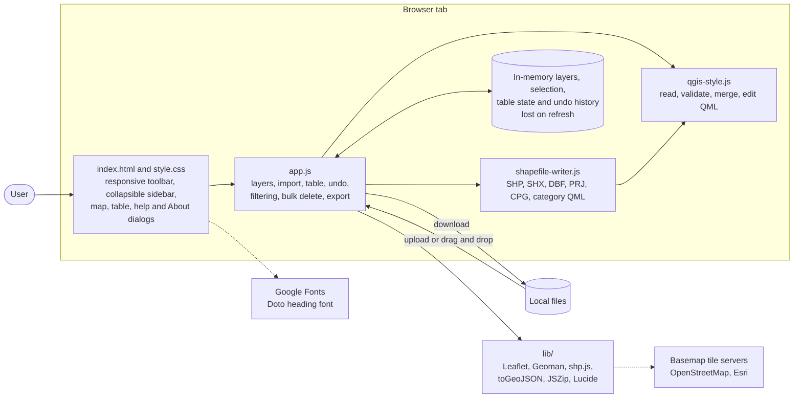
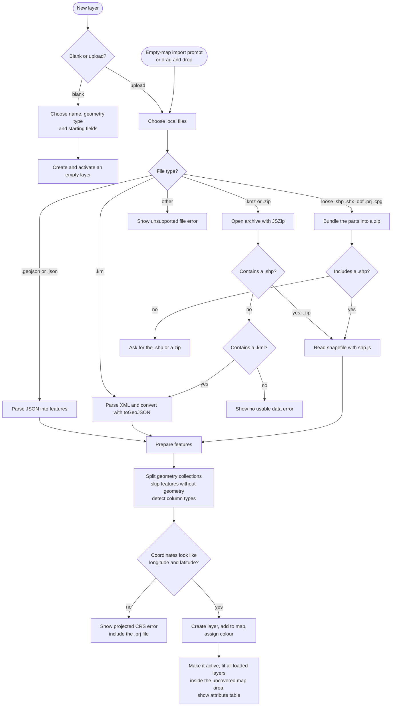
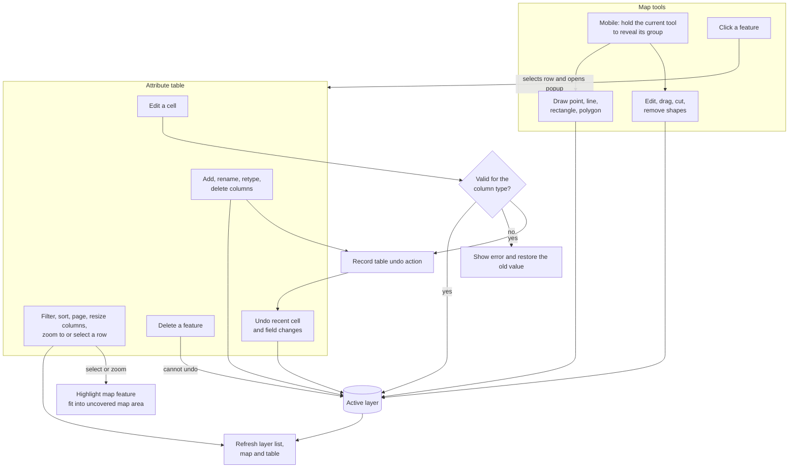
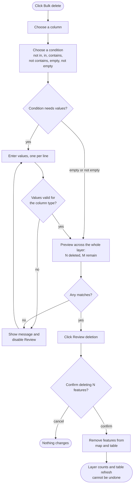
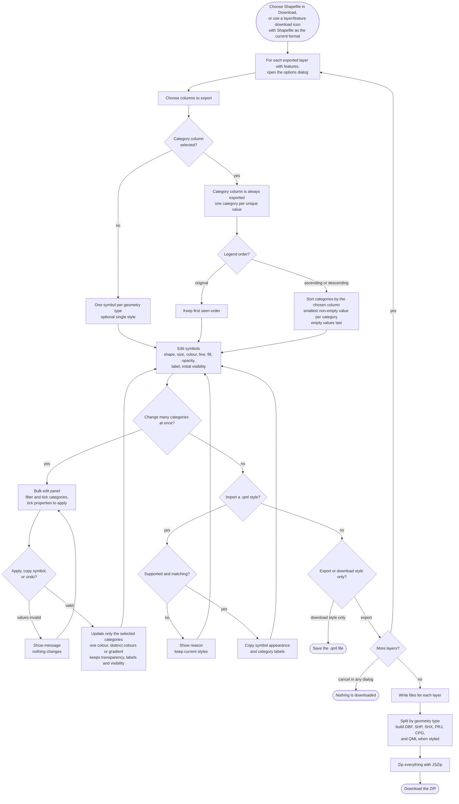
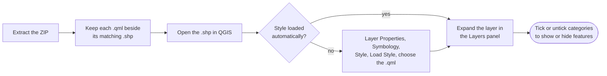
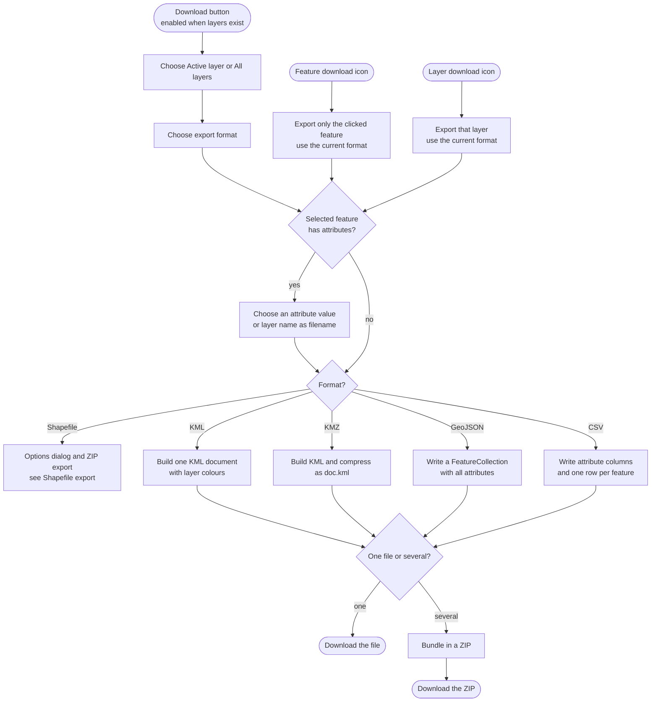
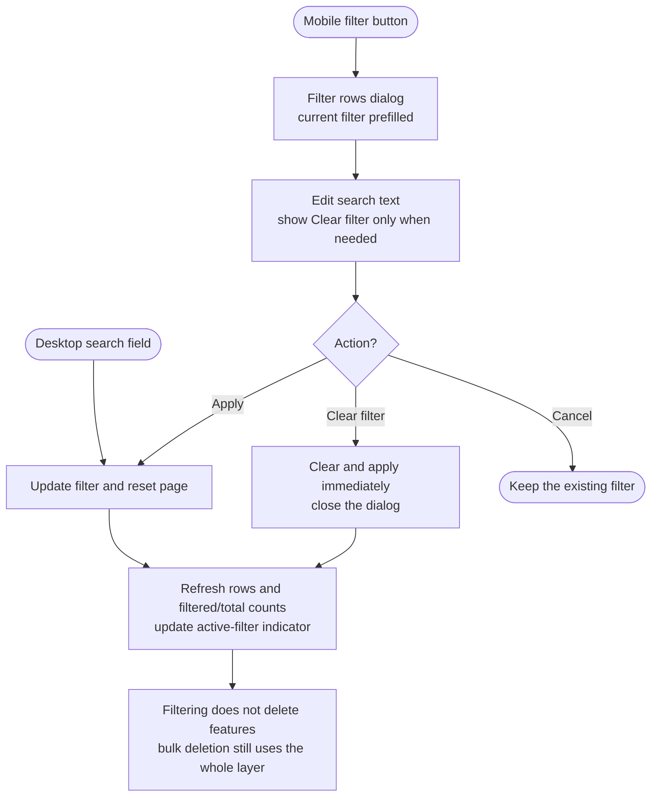
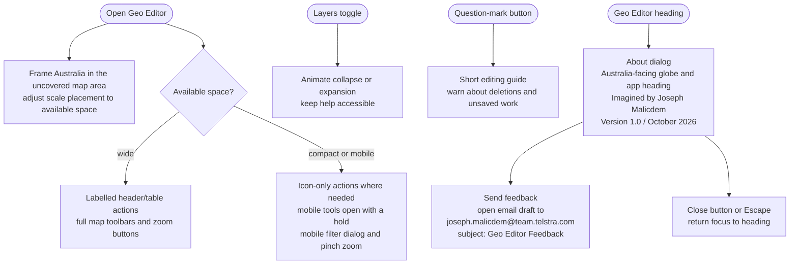

# Geo Editor flowcharts

**Version 1.0 | October 2026**

Diagrams of how Geo Editor works. They use [Mermaid](https://mermaid.js.org/), which GitHub and VS Code (with a Mermaid extension) render automatically.

See [README.md](./README.md) for the feature descriptions.

## 1. Overall architecture

Imported files and edits are processed in the browser. External requests fetch basemap tiles and the heading font, not uploaded file contents.

## 2. Importing files

## 3. Editing

## 4. Bulk delete

## 5. Shapefile export

## 6. Using the export in QGIS

## 7. Download workflow and other formats

Cancelling any export dialog stops the download without changing layers or the current selection. Per-feature exports use the clicked feature for filename values; all other features remain untouched.

## 8. Filtering rows

## 9. Responsive interface, help and About

Theme preference is remembered. Tooltips, radio selection, filter-clear reveals and notifications use the current theme and respect reduced-motion preferences where motion is used. Work remains in memory until downloaded; the About dialog does not send email automatically.
