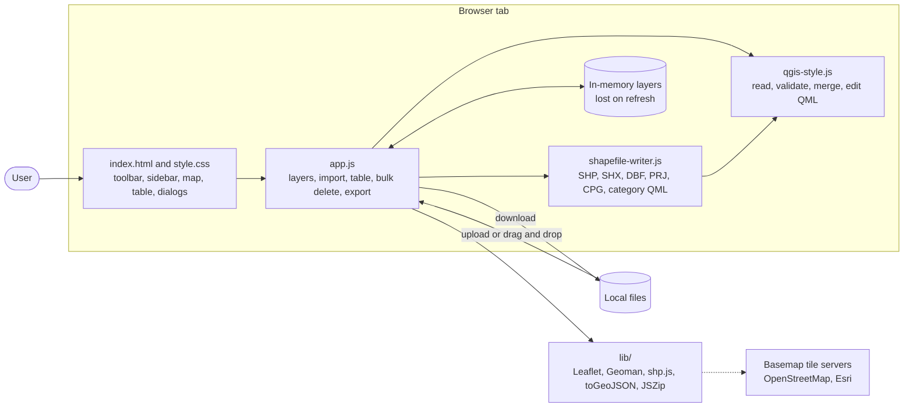
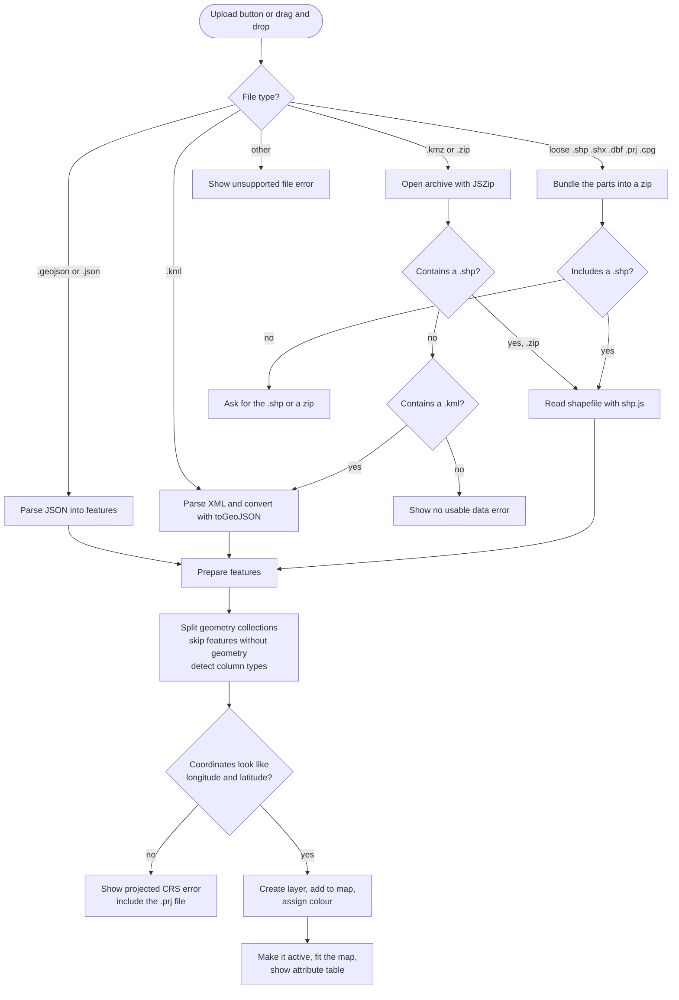
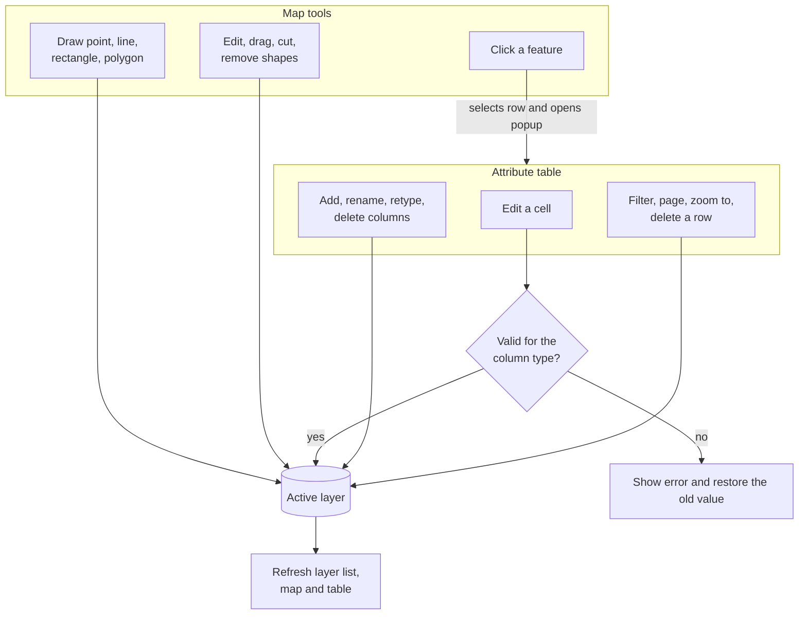
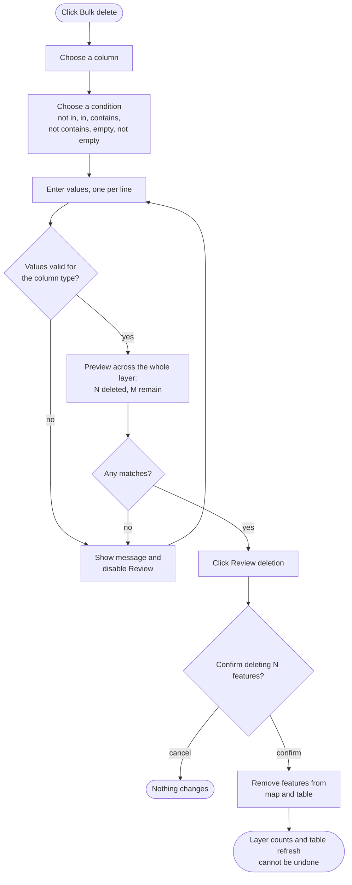
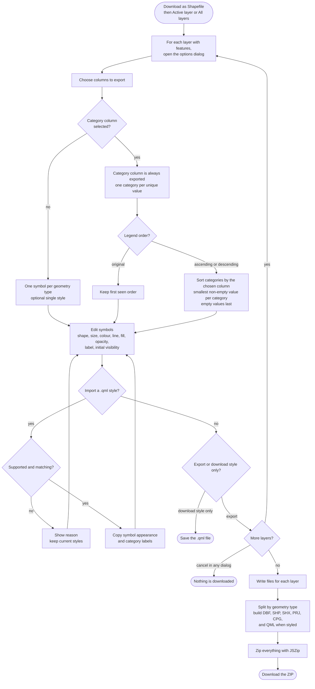
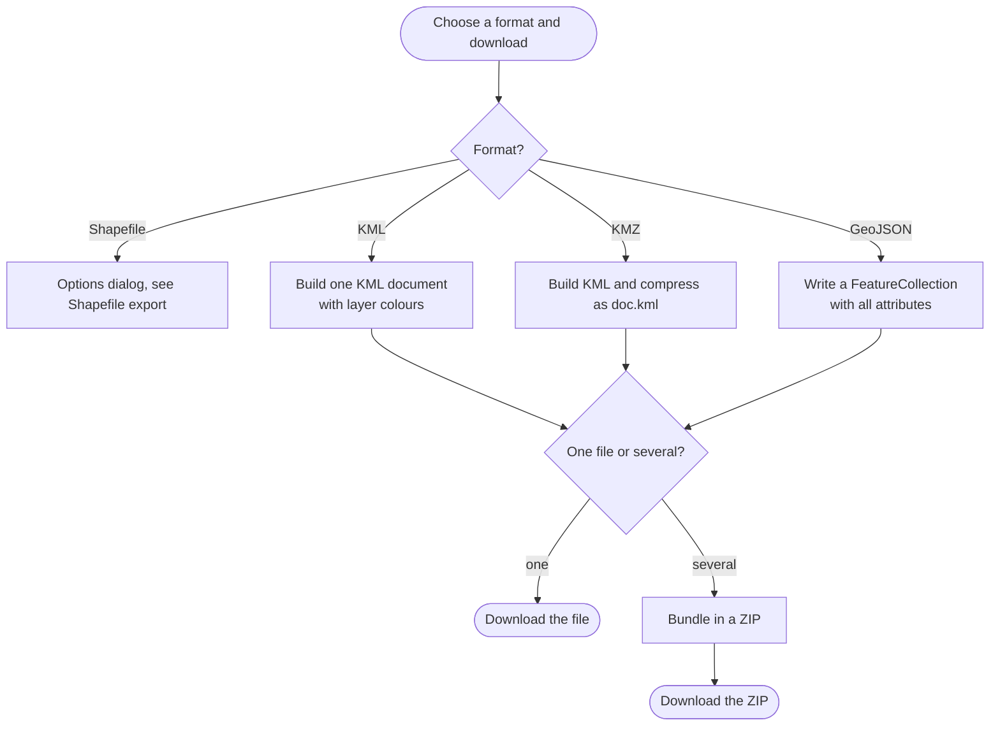

# Geo Editor flowcharts

Diagrams of how Geo Editor works. They use [Mermaid](https://mermaid.js.org/), which GitHub and VS Code (with a Mermaid extension) render automatically.

See [README.md](./README.md) for the feature descriptions.

## 1. Overall architecture

All processing happens in the browser; nothing is sent to a server.

## 2. Importing files

## 3. Editing

## 4. Bulk delete

## 5. Shapefile export

## 6. Using the export in QGIS

## 7. Other export formats

